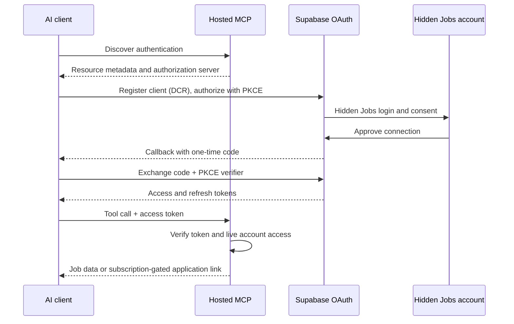

# Job Search MCP

Connect your AI client to Hidden Jobs to search remote technology jobs, inspect
full descriptions, compare roles and retrieve application links when your
account's Access subscription permits.

## Connect with your account

| Setting | Value |
| --- | --- |
| Remote MCP URL | `https://hiddenjobs.dev/mcp` |
| Authentication | OAuth |
| Sign-in | Your existing Hidden Jobs account |
| API key | Not needed |

1. Add a custom remote MCP server in your OAuth-capable AI client.
2. Enter the URL above and choose OAuth.
3. Sign in to Hidden Jobs and approve access.
4. Try: **“Find remote TypeScript jobs in Europe and summarize three matches.”**

The client obtains and refreshes access tokens automatically. You do not create
or paste an API key. OAuth still uses tokens internally; it is the way the client
obtains authorization for your account.

This is a provider-neutral MCP connection. ChatGPT uses this account OAuth flow. Other clients still need an end-to-end
compatibility check.
Clients need remote HTTP MCP, OAuth discovery, authorization code + PKCE and
HTTPS or HTTP loopback callbacks. Client UI, plans and workspace policies vary.
See [client configuration](docs/client-configuration.md).

[Browse jobs](https://hiddenjobs.dev/) · [Live MCP docs](https://hiddenjobs.dev/mcp/docs) · [REST API docs](https://hiddenjobs.dev/api/docs)

## Tools and access

| Tool | Account OAuth | API-key alternative |
| --- | --- | --- |
| `search_jobs` | Valid connected account | `jobs:read` |
| `get_job` | Valid connected account | `jobs:read` |
| `open_application_link` | Valid connected account + active Access subscription | `application-links:read` + active Access for the key owner |

Search and detail results omit original application URLs. Ask for
`open_application_link` when you want to apply; complete the application on the
employer's website. Subscription state is checked at request time.

The advertised OAuth scope is `email`, used for account identity. API-key scope
names such as `jobs:read` are not OAuth scopes. OAuth tool usage is limited to
600 calls per minute per account, shared across clients and separate from API-key quotas.
See [tool reference](docs/tool-reference.md).

## Account OAuth flow



DCR is enabled on the hosted service. A preconfigured client is an alternative
when its credentials and exact registered callback are configured in the AI
provider. The MCP URL alone does not select a preconfigured client.

## API-key alternative and public source

Clients that use bearer keys can continue to use `https://api.hiddenjobs.dev/mcp`.
Create a key in the [API keys dashboard](https://hiddenjobs.dev/dashboard/api-keys)
and configure it in the client's secret store. REST authentication is unchanged.
See [API-key configuration](docs/client-configuration.md#api-key-alternative).

**The Edge Function source in this repository implements the API-key adapter.**
It forwards the incoming key to the Hidden Jobs REST API. The hosted account
OAuth service uses native Supabase OAuth and a separate account MCP implementation;
that runtime, account database and billing implementation are not bundled here.
Deploying the included function does not reproduce hosted OAuth or its discovery.
See [architecture](docs/architecture.md) and [deployment](docs/deployment.md).

```json
{
  "mcpServers": {
    "hidden-jobs-api-key": {
      "url": "https://api.hiddenjobs.dev/mcp",
      "headers": { "Authorization": "Bearer hj_live_..." }
    }
  }
}
```

This fallback example is for clients supporting URL entries and custom headers.
Never commit a real credential or include it in a prompt.

## Development checks (API-key adapter)

```bash
deno task fmt
deno task check
```

The included `deno task smoke` checks the API-key adapter and requires
`HIDDEN_JOBS_API_KEY`. It does not implement an OAuth login or validate the full
hosted account flow. See [deployment](docs/deployment.md) for local setup.
The sample shell request in [examples/generic-jsonrpc.sh](examples/generic-jsonrpc.sh)
also targets the API-key alternative.

## Help and security

- [Client configuration and reconnection](docs/client-configuration.md)
- [Protocol and OAuth discovery](docs/protocol.md)
- [Tool reference and errors](docs/tool-reference.md)
- [Security policy](SECURITY.md)
- [Direct REST API](https://github.com/hiddenjobs/job-search-api)

Reconnect clients authorized before the native OAuth migration. Former custom
OAuth endpoints and opaque tokens are retired. Never send website session tokens
or Supabase keys to an AI client.

## License

MIT. See [LICENSE](LICENSE).
