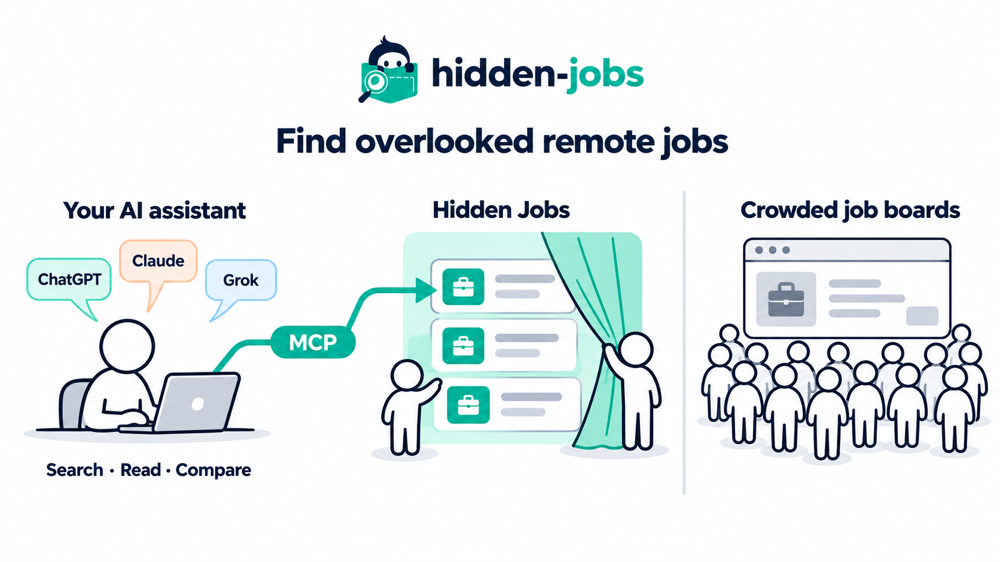
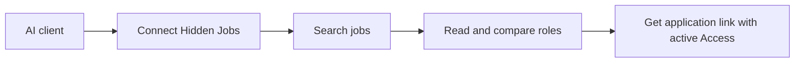

# Job Search MCP

Search remote technology jobs, read full descriptions, compare roles and retrieve application links
from your AI client.

<p align="center">
  
</p>

## Connect Hidden Jobs

| Setting        | Value                             |
| -------------- | --------------------------------- |
| Remote MCP URL | `https://hiddenjobs.dev/mcp`      |
| Authentication | OAuth                             |
| Account        | Your existing Hidden Jobs account |

Add the remote server to your AI client, sign in to Hidden Jobs and approve the connection. For
example: **“Find remote TypeScript jobs in Europe and summarize three matches.”** See
[client configuration](docs/client-configuration.md) for ChatGPT, graphical clients and terminal
setup.

[Browse jobs](https://hiddenjobs.dev/) · [Live MCP documentation](https://hiddenjobs.dev/mcp/docs)

## Terminal setup

**Claude Code**

```bash
claude mcp add --transport http hidden-jobs https://hiddenjobs.dev/mcp
claude mcp login hidden-jobs
```

**Codex CLI**

```bash
codex mcp add hidden-jobs --url https://hiddenjobs.dev/mcp
codex mcp login hidden-jobs
```

Complete sign-in and approval in your browser, then return to the terminal. See
[client configuration](docs/client-configuration.md) for version support and verification commands.

## Tools

| Tool                    | Purpose                                    | Access                               |
| ----------------------- | ------------------------------------------ | ------------------------------------ |
| `search_jobs`           | Search by keywords and filters             | Connected account                    |
| `get_job`               | Read a role's details and full description | Connected account                    |
| `open_application_link` | Retrieve the original application URL      | Connected account with active Access |

Search and detail results do not include original application URLs. Use `open_application_link` when
you want to apply, then complete your application on the employer's website. Access is checked at
request time. The limit is 600 tool calls per minute per account across connected clients.



## Documentation

- [Client configuration](docs/client-configuration.md)
- [Tool reference](docs/tool-reference.md)
- [Protocol reference](docs/protocol.md)
- [How it works](docs/architecture.md)
- [Connection verification](docs/deployment.md)
- [Security](SECURITY.md)
- [Contributing](CONTRIBUTING.md)

## License

MIT. See [LICENSE](LICENSE).
