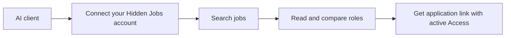

# Job Search MCP

Connect your AI client to Hidden Jobs to search remote technology jobs, inspect
full descriptions, compare roles and retrieve application links when your
account's Access subscription permits.

## Connect with your account

| Setting | Value |
| --- | --- |
| Remote MCP URL | `https://hiddenjobs.dev/mcp` |
| Authentication | OAuth |
| Sign-in | Your existing Hidden Jobs account |
| API key | Not needed |

1. Add a custom remote MCP server in your OAuth-capable AI client.
2. Enter the URL above and choose OAuth.
3. Sign in to Hidden Jobs and approve access.
4. Try: **“Find remote TypeScript jobs in Europe and summarize three matches.”**

Connect using your existing Hidden Jobs account. No API key is needed for this
connection. Use a client that supports remote HTTP MCP and OAuth, such as
ChatGPT or another compatible AI client. Availability depends on your client's
account and workspace settings. See [client configuration](docs/client-configuration.md).

[Browse jobs](https://hiddenjobs.dev/) · [Live MCP docs](https://hiddenjobs.dev/mcp/docs) · [REST API docs](https://hiddenjobs.dev/api/docs)

## Tools and access

| Tool | Account OAuth | API-key alternative |
| --- | --- | --- |
| `search_jobs` | Valid connected account | `jobs:read` |
| `get_job` | Valid connected account | `jobs:read` |
| `open_application_link` | Valid connected account + active Access subscription | `application-links:read` + active Access for the key owner |

Search and detail results omit original application URLs. Ask for
`open_application_link` when you want to apply; complete the application on the
employer's website. Subscription state is checked at request time.

Account connections allow up to 600 tool calls per minute, shared across your
connected clients. API-key connections use their configured limits.
See [tool reference](docs/tool-reference.md).

## How it works



## API-key alternative

Clients that use bearer keys can continue to use `https://api.hiddenjobs.dev/mcp`.
Create a key in the [API keys dashboard](https://hiddenjobs.dev/dashboard/api-keys)
and configure it in the client's secret store. REST authentication is unchanged.
See [API-key configuration](docs/client-configuration.md#api-key-alternative).

The included server source provides the API-key connection. To use account
sign-in, connect to the hosted endpoint above. See [development](docs/deployment.md)
for running the included server locally.

```json
{
  "mcpServers": {
    "hidden-jobs-api-key": {
      "url": "https://api.hiddenjobs.dev/mcp",
      "headers": { "Authorization": "Bearer hj_live_..." }
    }
  }
}
```

This fallback example is for clients supporting URL entries and custom headers.
Never commit a real credential or include it in a prompt.

## Development checks (API-key adapter)

```bash
deno task fmt
deno task check
```

The included `deno task smoke` checks the API-key adapter and requires
`HIDDEN_JOBS_API_KEY`. It does not implement an OAuth login or validate the full
hosted account flow. See [deployment](docs/deployment.md) for local setup.
The sample shell request in [examples/generic-jsonrpc.sh](examples/generic-jsonrpc.sh)
also targets the API-key alternative.

## Help and security

- [Client configuration and reconnection](docs/client-configuration.md)
- [Protocol reference](docs/protocol.md)
- [Tool reference and errors](docs/tool-reference.md)
- [Security policy](SECURITY.md)
- [Direct REST API](https://github.com/hiddenjobs/job-search-api)

If a connection stops working, reconnect it from your AI client. Keep credentials
out of prompts, logs and source control.

## License

MIT. See [LICENSE](LICENSE).
