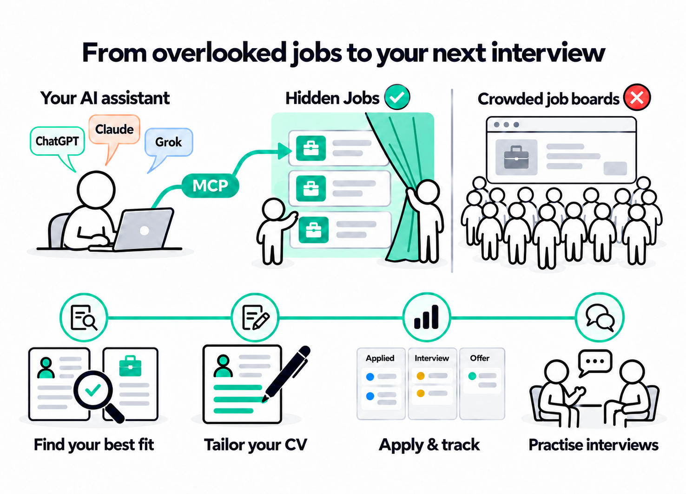

# Job Search MCP

_Your job search, with your AI assistant._

Find overlooked remote jobs, evaluate your fit, tailor your CV and cover letter, prepare for
interviews and track every application. Connect your assistant to Hidden Jobs and keep your profile,
CV versions, email alerts and application history together in your account.



[Connect](#quick-start) · [Sources](docs/job-sources.md) · [Skills](#skills) · [Tools](#tools) · [Resources](#resources) ·
[Documentation](#documentation)

## How it works

```text
Your profile + selected CV
            ↓
 Find jobs in your sources
            ↓
      Compare + choose
            ↓
 Tailor CV + cover letter
            ↓
    Review + export PDF
            ↓
   Send your application
            ↓
   Track + prep interviews
```

Your assistant does the analysis and writing. Hidden Jobs supplies the offers and saves the profile,
documents and progress you ask to keep. Use the same saved information from the connected clients
you authorize.

## Quick start

### 1. Connect your assistant

| Setting        | Value                        |
| -------------- | ---------------------------- |
| MCP URL        | `https://hiddenjobs.dev/mcp` |
| Authentication | OAuth                        |
| Account        | Your Hidden Jobs account     |

Add a custom remote MCP server in your assistant, enter the URL, sign in to Hidden Jobs and approve
the connection.

**Claude Code**

```bash
claude mcp add --transport http hidden-jobs https://hiddenjobs.dev/mcp
claude mcp login hidden-jobs
```

**Codex CLI**

```bash
codex mcp add hidden-jobs --url https://hiddenjobs.dev/mcp
codex mcp login hidden-jobs
```

Complete sign-in in your browser, then return to your client. See
[client configuration](docs/client-configuration.md) for graphical clients, terminal verification
and troubleshooting.

### 2. Set up your profile and CVs

Once connected, ask your assistant to build your profile and save your CVs.

> Set up my profile from this CV. Save it as Backend English and ask me about any missing details.

Keep multiple CVs, such as Backend English and Manager Spanish, with immutable version history.
Choose the CV and exact version for each application, or ask your assistant to choose the best match
for the offer. Transfer files through your client's supported file capability, or upload them in
**Profile**.

### 3. Find and compare jobs

> Search Hidden Jobs and Remote OK for TypeScript roles open to applicants in Spain. Compare
> three offers against Backend English, version 3, and explain the best match.

Choose sources in `search_jobs`: Hidden Jobs, Jobicy, We Work Remotely, Remote OK or Himalayas.
`sources` is required, with at least one selection and no default. Reading an offer or opening its
link also requires the returned `source`. Use `open_application_link` to retrieve original application links. External offers are queried through
public APIs/feeds and are not stored in Hidden Jobs. You can compare them and prepare documents;
saved job evaluations, activity, application tracking and email alerts use Hidden Jobs offers.
See [job sources](docs/job-sources.md).

### 4. Prepare your application

> For this Hidden Jobs role, use Backend English, version 3, to tailor my CV and write a cover
> letter. Review both, save the application and export the final CV as a PDF.

> Compare all my saved CVs against this offer, choose the best match, explain why, and use it to
> tailor my CV and prepare the application.

Your assistant compares the content of your saved CVs against the role and uses the exact selected
version. You can name a specific CV instead, and your default CV stays unchanged.

The assistant saves a snapshot of the offer and the chosen CV version, drafts documents from
confirmed facts, reviews them and links the final documents to the application. Creating version 4
later does not replace the version already selected for that application.

You review and submit on the employer's website. Then ask your assistant to record the submission.

### 5. Track and prepare for interviews

> I submitted this application today. Mark it as applied and save the next step.

> Prepare me for the first interview using the role, company information and the CV I used.

Open **Applications** to see your pipeline, filter statuses and review history, documents, notes and
next steps. Use **Profile** for your experience, CV library and connected applications.

## Email job alerts

> Create a daily alert for Backend or DevOps jobs in Europe matching TypeScript.

> Change that alert to weekly. Pause it for now, then show me my other alerts.

Manage the same alerts as the dashboard: up to five saved searches, daily or weekly emails, and
multiple filter selections. Creating, modifying or resuming requires a confirmed account email. You can also pause all alerts or delete them. See
[job alerts](docs/job-alerts.md) for filters, version conflicts and examples.

## Skills

15 portable skills guide the complete workflow. Each directory contains a `SKILL.md` with
instructions your assistant can follow.

| Skill                                          | What it helps you do                                                                                                  |
| ---------------------------------------------- | --------------------------------------------------------------------------------------------------------------------- |
| [`alerts`](skills/alerts/SKILL.md)             | Create daily or weekly email alerts, change filters, and pause or resume delivery.                                    |
| [`setup`](skills/setup/SKILL.md)               | Build your profile — Import a CV, confirm your experience and preferences, and choose a default CV.                   |
| [`expand`](skills/expand/SKILL.md)             | Add depth to your profile — Capture achievements, responsibilities and examples that make applications specific.      |
| [`search`](skills/search/SKILL.md)             | Search selected sources, check location eligibility and preserve provider attribution.                                |
| [`match`](skills/match/SKILL.md)               | Compare your matches — Evaluate requirements against your chosen CV and explain the ranking.                          |
| [`apply`](skills/apply/SKILL.md)               | Tailor an application — Draft a tailored CV and cover letter, preserve the base CV version, and save the application. |
| [`review`](skills/review/SKILL.md)             | Review before sending — Check facts, relevance, clarity and unsupported claims in the draft.                          |
| [`export`](skills/export/SKILL.md)             | Download a PDF — Generate a PDF from a saved document and check its text and layout limits.                           |
| [`interview`](skills/interview/SKILL.md)       | Prepare for interviews — Practise likely questions and evidence-based answers using the offer and your experience.    |
| [`upskill`](skills/upskill/SKILL.md)           | Build a learning plan — Turn requirements you want to develop into exercises and milestones.                          |
| [`outcome`](skills/outcome/SKILL.md)           | Track applications — Record confirmed submissions, interviews, offers, rejections and next steps.                     |
| [`email-sync`](skills/email-sync/SKILL.md)     | Review email updates — Use your separately connected email to propose application updates for your approval.          |
| [`report`](skills/report/SKILL.md)             | Review your progress — Summarize your pipeline, recent activity and next actions; save a report when requested.       |
| [`add-template`](skills/add-template/SKILL.md) | Use your own structure — Save document structure and supported PDF layout settings.                                   |
| [`reset`](skills/reset/SKILL.md)               | Manage saved data — Preview deletion and open your account for explicit confirmation.                                 |

For example: **“Use apply to prepare this application, then review to check it.”**

Install the selected skill directories using your client's skill support. A remote MCP connection
does not automatically install local skill files. You can also request the same instructions as MCP
prompts, workflow resources or through `get_workflow`; this supports clients with different
interfaces.

See the [skills guide](docs/skills.md) for examples, the tools each workflow uses and how to run it
from a remote chat.

## Tools

45 tools expose job search, email alerts, private career data and document operations. Tools read or save
information; your assistant evaluates offers, personalizes your CV, writes letters and leads
interview practice.

| Area                   | Tools                                                                                                                                                                                                                                    |
| ---------------------- | ---------------------------------------------------------------------------------------------------------------------------------------------------------------------------------------------------------------------------------------- |
| Jobs and companies     | `search_jobs`, `get_job`, `open_application_link`, `get_company`                                                                                                                                                                         |
| Job alerts             | `get_job_alerts`, `create_job_alert`, `update_job_alert`, `delete_job_alert`, `pause_job_alerts`, `resume_job_alerts`                                                                                                                    |
| Workflow instructions  | `get_workflow`                                                                                                                                                                                                                           |
| Profile                | `get_candidate_profile`, `save_candidate_profile`                                                                                                                                                                                        |
| CV library             | `list_cvs`, `get_cv`, `save_cv`, `update_cv`, `set_default_cv`, `select_application_cv`                                                                                                                                                  |
| Documents              | `create_document_upload`, `upload_document_chunk`, `finalize_document_upload`, `import_document`, `list_documents`, `get_document`, `get_document_download_url`, `save_document`, `delete_document`, `render_document`, `check_document` |
| Search and evaluations | `get_search_history`, `save_search_history`, `list_job_activity`, `update_job_activity`, `get_job_evaluations`, `save_job_evaluation`                                                                                                    |
| Applications           | `list_applications`, `get_application`, `save_application`, `update_application`, `get_application_report`                                                                                                                               |
| Learning               | `get_learning_plan`, `save_learning_plan`                                                                                                                                                                                                |
| Data controls          | `export_user_data`, `reset_user_data`                                                                                                                                                                                                    |

For example, preparing an application uses `get_cv` → `save_application` → `save_document` →
`update_application`. PDF export adds `render_document`, `check_document` and
`get_document_download_url`.

See the [complete tool reference](docs/tool-reference.md) for arguments, examples, permissions and
errors.

## Resources

Resources give your assistant reusable instructions, templates and access to your saved career
information.

| Resource URI                        | Contents                                                                  |
| ----------------------------------- | ------------------------------------------------------------------------- |
| `hiddenjobs://workflows/{name}`     | The 15 workflows listed above, such as `apply`, `interview` and `outcome` |
| `hiddenjobs://guides/{name}`        | `job-evaluation`, `document-review`, `interview`, `ats-checks`            |
| `hiddenjobs://templates/{name}`     | `cv`, `cover-letter`, `interview`                                         |
| `hiddenjobs://me/profile`           | Your confirmed profile and preferences                                    |
| `hiddenjobs://me/cvs/{id}`          | A saved CV and its versions                                               |
| `hiddenjobs://me/applications/{id}` | A saved application and its history                                       |
| `hiddenjobs://me/documents/{id}`    | A document's saved text and metadata                                      |

For example, `hiddenjobs://workflows/interview` explains how to prepare for an interview;
`hiddenjobs://me/applications/{id}` supplies the saved application to work from. Private resources
enforce the same OAuth and account-ownership checks as the tools. Use `resources/templates/list` to
discover private URI patterns and the list/get tools to obtain record IDs.

The 15 MCP prompts use the workflow names: `alerts`, `setup`, `expand`, `search`, `match`, `apply`, `review`,
`export`, `interview`, `upskill`, `outcome`, `email-sync`, `report`, `add-template`, `reset`. See
the [resources and prompts reference](docs/resources.md).

## Your data and documents

- Profile facts, CVs, immutable CV versions, drafts, evaluations, interview notes, learning plans
  and application history are stored privately in your Hidden Jobs account, rather than relying on a
  local project folder.
- Your OAuth-authorized applications can work with your saved career data. Export your data or
  confirm deletion from your account.
- PDF, DOCX and UTF-8 text/Markdown uploads support up to 2 MiB per file and 20 PDF pages. PDF
  export supports Latin text and validated layout settings. Review the final PDF before sending it.
- Application states are `saved`, `preparing`, `prepared`, `applied`, `interview`, `offer`,
  `rejected` and `withdrawn`. Prepared documents are not sent automatically; submission and outcome
  changes are recorded with your confirmation.
- Email updates use your separately authorized email connector and your approval. Hidden Jobs keeps
  approved references and summaries, not mailbox credentials or email bodies.

See the [career workspace guide](docs/career-workspace.md) for storage, document transfer,
application tracking and templates.

## Documentation

This repository contains the MCP protocol, REST implementations of every tool, skills, resources and
client connection guides. The remote connector uses the same HTTP adapter published here. The hosted
backend and account dashboards are maintained in the Hidden Jobs application repository.

- [Client configuration](docs/client-configuration.md)
- [REST adapter and tool routes](docs/rest-adapter.md)
- [Skills and workflow examples](docs/skills.md)
- [Complete tool reference](docs/tool-reference.md)
- [Resources and prompts](docs/resources.md)
- [Career workspace](docs/career-workspace.md)
- [Protocol](docs/protocol.md)
- [Architecture](docs/architecture.md)
- [Development](docs/development.md)
- [Security](SECURITY.md) · [Contributing](CONTRIBUTING.md)

## License

MIT. See [LICENSE](LICENSE).

Employer names and identifying job slugs are withheld from search and detail results. `get_company`
provides anonymous company context using a job ID. If an operation requires account action, the assistant receives a link to the account settings.
