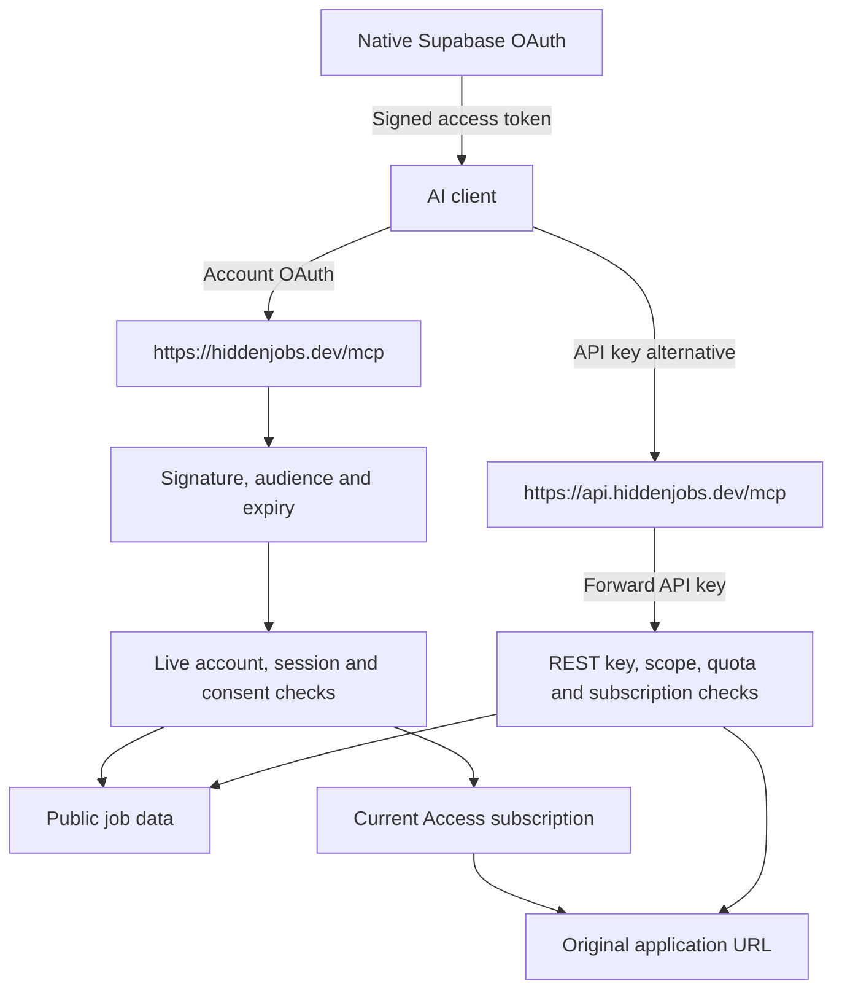

# Architecture

The hosted service offers two separate authentication paths.

## Account OAuth

Resource metadata identifies Supabase as the authorization server. The client
uses discovery, DCR and authorization code + PKCE. Users sign in and consent on
Hidden Jobs. Supabase issues tokens for the user's account; the client handles
refresh. The website session token is never passed to the AI client.

The account MCP validates the signed token and checks live session, consent and
account state. It checks current Access before returning an application link.
Search and job details do not expose original application URLs. `email` is an
identity scope, not a database or API-key permission. OAuth tokens do not grant
direct database access. Account OAuth quota: 600 tool calls/minute across clients.

Example: an account whose Access subscription expires can still search jobs,
but `open_application_link` returns a subscription-required error.

## Public source boundary

The function in this repository is the **API-key adapter**, not the hosted account
OAuth runtime. It forwards the original API key to REST; REST enforces key scopes,
usage limits and subscription access. It does not perform OAuth discovery or login.
Deploying it unchanged will not enable account OAuth on a new server.

The repository does not contain the hosted account database, native account MCP
implementation, billing logic, customer data or service-role credentials.
[Deployment](deployment.md) covers only the included adapter.
