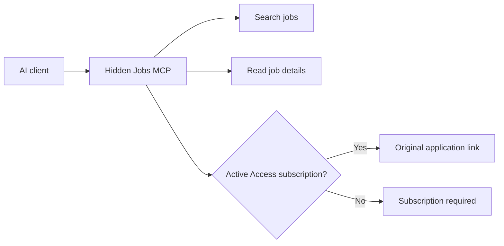

# How the MCP works

Connect your Hidden Jobs account once, then use the tools from your AI client.
The server checks access on every request. Search and job details never include
the original application URL; retrieve it with `open_application_link` when you
want to apply.

Example: search for remote TypeScript jobs, compare the descriptions and request
the application link for your preferred role. An active Access subscription is
required for that final step.

See [client configuration](client-configuration.md), [tool reference](tool-reference.md)
and [connection verification](deployment.md).
