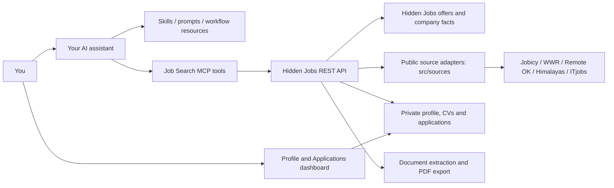

# How Job Search MCP works

The assistant runs the language model. Skills, prompts and `get_workflow` supply a shared set of
instructions. Tools search offers and persist the assistant's user-approved work. Resources expose
guidance, templates and permitted private records.

For example, **“Prepare my application using Backend English, version 3”** loads the apply workflow,
reads your confirmed profile and selected CV, captures the offer, saves a tailored CV and letter,
and marks the application prepared. You review the documents and submit on the employer's website.
The outcome workflow records your confirmed submission or later interview/offer.

## Connection and access

Your MCP client discovers OAuth metadata from the resource URL, signs you in to Hidden Jobs and
attaches an account token to requests. The MCP forwards that token to its first-party REST API,
which verifies the signature and checks live session/consent validity before each authenticated
operation.

Job search and descriptions are available to connected accounts. Only `open_application_link`
returns a Hidden Jobs original employer URL. External sources return their provider links for free, with attribution; their offers are never imported into the Hidden Jobs database. The same OAuth connection
authorizes career reads and writes for that account.

## Instructions and operations

| Layer                           | Responsibility                                                                                         |
| ------------------------------- | ------------------------------------------------------------------------------------------------------ |
| 15 skills / prompts / workflows | Guide setup, search, ranking, tailoring, review, export, interviews and tracking                       |
| 44 tools                        | Read and save account data, search offers and transfer/render documents                                |
| 22 shared resources             | Workflow instructions, review guides and text templates                                                |
| Four private resource patterns  | Profile, CV, application and document access with OAuth and account ownership                          |
| Your assistant                  | Analysis, writing, interview practice and proposed updates                                             |
| Hidden Jobs                     | User-approved storage, ownership checks, history, revisions, file operations and account access checks |

The canonical workflow source is [`src/resources/workflows.ts`](../src/resources/workflows.ts).
Skill files are generated from it, while prompts and resources read it directly. Neither importing a
skill nor reading a resource automatically submits an application.

## Data integrity

Applications retain an offer snapshot and exact base CV version. New CV versions do not replace
historical selections. After submission, base CV selection and final CV/cover-letter references
cannot be rewritten. Application updates append events.

Writes use last-read revisions and idempotency keys. Ownership checks reject cross-account
references. Private files use generated owner paths and expiring download/upload capabilities. The
account UI lists active connections and handles confirmed data deletion.

See [client setup](client-configuration.md), [skills](skills.md), [tools](tool-reference.md),
[resources](resources.md), [workspace](career-workspace.md) and
[developer configuration](development.md).
